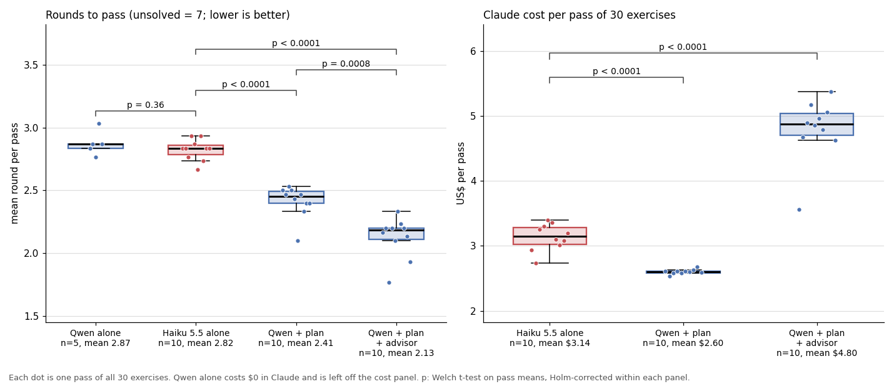

# Benchmark: the Claude settings

Which optional Claude calls are worth turning on, and what do they cost? The local coder is
Qwen3.8-Flash-Next ($0 in API dollars). Claude is Opus 5.5 with read tools on; costs are
API-equivalent dollars at list price. For a price comparison, Claude Haiku 5.5 also ran as
the coder on its own, priced at what Claude Code recorded.

**Setup:** the 30 Aider polyglot exercises the local model failed most often (C++, Go, Java,
JavaScript, Python, Rust), run with `qwen-agent --until-done` for up to six rounds; after each
round the hidden tests run and the failures go to the next round. **Score:** the round in
which every test first passes, unsolved = 7, lower is better. 5 or 10 full passes per setup,
1,800 exercise runs (October 2026).

## Results

| setup | passes | mean round | passed in round 1 | Claude cost per exercise | rounds vs plan (Tukey p) |
|---|---|---|---|---|---|
| Qwen alone | 5 | 2.87 | 4% | $0 | +0.46 (<0.0001) |
| Haiku 5.5 as the coder (no Qwen) | 10 | 2.82 | 10% | $0.10 | +0.41 (<0.0001) |
| advisor only | 5 | 2.61 | 10% | $0.10 | +0.19 (0.28) |
| plan | 10 | 2.41 | 24% | $0.09 | – |
| **plan + advisor** | 10 | **2.13** | **34%** | $0.16 | **-0.29 (0.002)** |
| plan + rescue | 5 | 2.17 | 23% | $0.18 | -0.25 (0.07) |
| plan + advisor + rescue | 5 | 2.12 | 31% | $0.24 | -0.29 (0.015) |

Each dot is one pass of 30 exercises; the p-values on the figure are Welch t-tests on pass
means, Holm-corrected within each panel.

Plan reviews the approach once, before the first file edit; advisor gives the coder an `ask`
tool (up to 4 questions per run); rescue diagnoses each failing round for the next one
([qwen-agent.md](qwen-agent.md#advisor---advisor-model-experimental)).

## What the numbers say

- **Claude makes the coder faster, not more often right.** Every Qwen setup solved 96-99% of
  the exercises; Haiku solved 94%.
- **Plan is most of the gain** (2.87 to 2.41 rounds) for one call per exercise. **Advisor on
  top** saves 0.29 more (95% interval over exercises -0.49 to -0.13). Rescue on top of
  plan + advisor added nothing (2.13 to 2.12) and cost the most.
- **Haiku as the coder matched Qwen alone** (2.82 against 2.87, Welch p=0.36), and **Qwen +
  plan beat it on rounds and on cost**: $2.60 of Claude per 30 exercises against $3.14
  (p<0.0001). Plan costs the same on every exercise while Haiku's varies, so on a different
  exercise set the cost gap could close.

**Recommended:** plan + advisor (`QWEN_PLAN=opus`, `QWEN_ADVISOR=opus`), about $4.80 of Claude
per 30 hard exercises; rescue stays off. This matches Anthropic's advisor findings that calls
at fixed points beat leaving the call to the executor
([advisor strategy](https://platform.claude.com/docs/en/about-claude/models/optimizing-for-cost-and-intelligence#advisor-strategy-escalate-hard-decisions),
[advisor tool](https://platform.claude.com/docs/en/agents-and-tools/tool-use/advisor-tool)).

**Statistics:** across all setups, ANOVA on pass means F=33.8, p=3.4e-17 (60 passes). The
table's p is Tukey HSD over all pairs. Because every pass repeats the same 30 exercises,
intervals are bootstrapped over exercises (10,000 draws). **Limits:** one local model, one
task set, today's prices; five-pass setups cannot rule out small effects. Wall-clock time is
not compared: the Haiku runs did not use the local GPU.

## How the runs were kept honest

- **No answer keys.** The coder has no web tools, and the hosts serving the exercises' tests
  and reference solutions are blocked. Claude is told not to recite them from memory.
- **Recall check.** Haiku passed in round 1 more often than Qwen alone (10% against 4%), but
  not once repeats of the same exercise are accounted for (p=0.30). That cannot prove
  nothing was recalled.
- **Missing helper files.** Some exercises use helper files the grader adds but the coder's
  copy lacks. Qwen wrote them on its own; Haiku got one extra instruction line allowing it.
- **All tests count, graded separately.** Every test case is enabled (Harbor's adapter runs
  only the first for C++, Rust and JavaScript), and each check runs in a fresh container.
